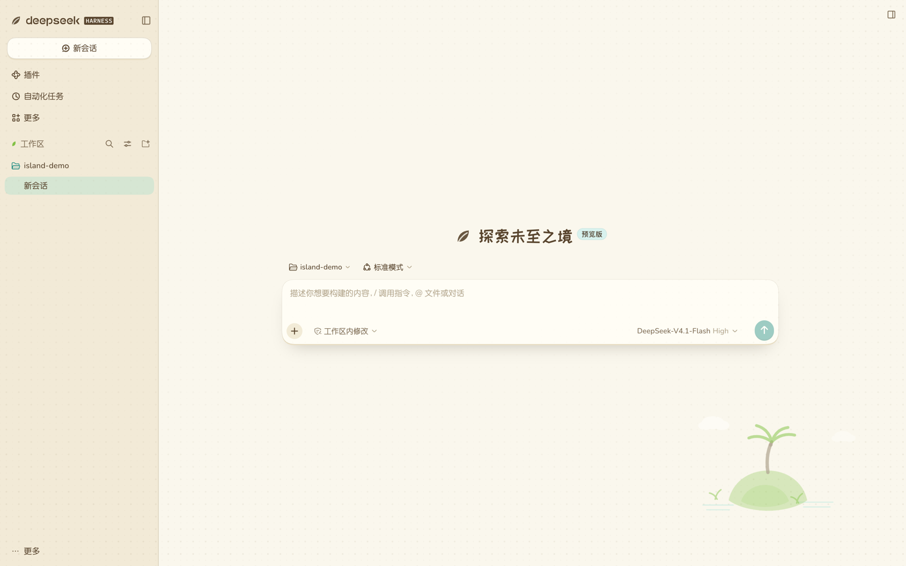
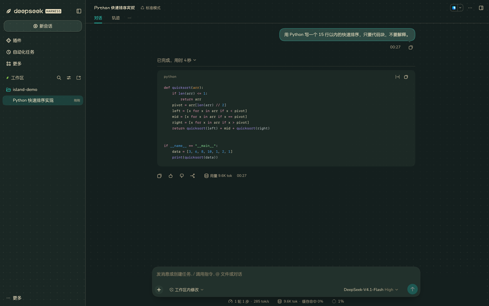

# 动森皮肤 · Animal Island skin

DeepSeek Harness Web 客户端的动森风格皮肤：奶油纸底、大地棕文字、薄荷强调、波点壁纸，亮色「白天岛」与暗色「森林夜」两套。

[English](README.md)




## 安装

需要 `dsh` ≥ 0.2.2-rc.1，装完重启。

```sh
dsh plugin --profile web add "git+https://github.com/sharkAndshark/dsh-skin-animal-island.git#SHA&path:/skin-animal-island"
```

或在应用里：**插件 → 发现 → 添加索引源** →
`https://cdn.jsdelivr.net/gh/sharkAndshark/dsh-skin-animal-island@v0.1.1/market/index.json`

## 关闭

插件页关掉该行，或 `config: { enabled: false }`。

## 许可

代码 MIT；字体 OFL 1.1，见 `skin-animal-island/assets/fonts/`。
